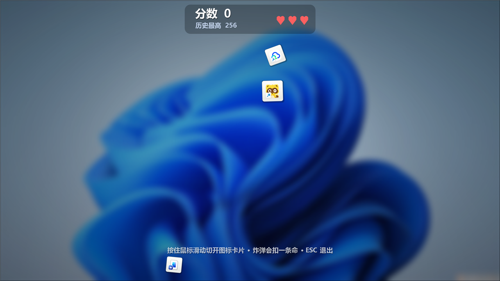
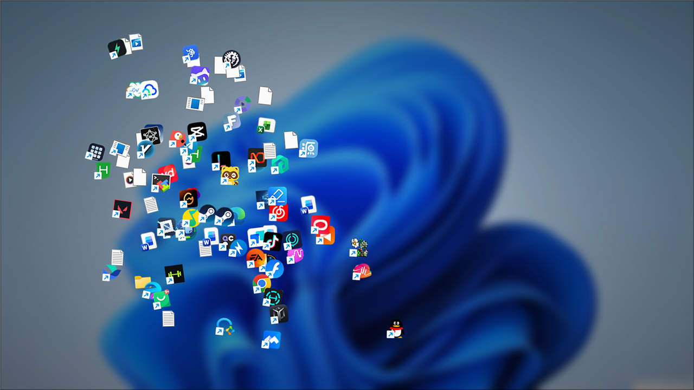

# 桌面图标忍者 · Desktop Icon Ninja

> 把 Windows 桌面图标当成水果切——办公室摸鱼解压小游戏。
> **切中只加分、出特效、播音效，绝不会打开任何程序。**

纯 **C# WinForms** 单文件实现（源码就一个 `DesktopIconNinja.cs`），用系统自带的 `csc` 编译成**单文件 exe**，不依赖任何第三方库、不装服务、不写注册表。



点「开始游戏」后，你桌面上的图标会先被"吸"到屏幕正中间聚成一堆，再一起掉下去，然后才开始出图标：



---

## 下载即玩

到 [Releases](../../releases/latest) 下载 `DesktopIconNinja.exe`，双击即可（无需安装）。

- 首次运行弹出设置窗口：**生成速度**、**参与游戏的图标数量**、**音效开关**
- 图标数量可以直接点数字手输：**最低 6**（输入更小会被强制改成 6），**最高等于你桌面上的图标总数**
- 进游戏后**按住鼠标左键拖动**划过图标就算切开
- `ESC` 立刻退出（摸鱼跑路键）；游戏结束后按 `空格` 用同一套设置重开

## 规则（经典模式）

| 项目 | 规则 |
|---|---|
| 生命 | 3 条（HUD 居中显示）；漏掉一个图标扣 1 条，切到炸弹也扣 1 条，扣完才结束 |
| 普通图标 | +1 分；卡片尺寸在 5 档固定区间内随机 |
| 连击 | 0.62 秒窗口内连续切中 ≥2 个算连击，第 2 个起每多切一个 **+5 分**，"连击 ×N" 金色大字每次重弹 |
| 纸屑 | 切开后碎片留在画面 2 秒淡出，夹在卡片后面 |
| 炸弹 | 约 **13%** 概率出现，**开局第一个绝不会是炸弹**；切到爆炸并扣一条命，漏掉不扣命 |
| 巨型图标 | 每 **15~30 秒随机**出现，个头近普通图标两倍，带脉动红光 + 旋转警戒环 + 全屏红色暗角；在场时暂停刷普通图标和炸弹 |
| 巨型图标判定 | 只统计划在它身上的刀（段长 ≥10px），目标刀数在 **50~120** 间随机，限时 5 秒；只要还在切就一直有连贯的"挥刀"声，刀痕会划过整张卡片（含白边）并崩出碎屑，但没切够绝不破裂 |
| 巨型图标成功 | 得分 = 命中刀数 × 2，撕成大量纸屑，弹出"拆开！+得分"，并播一句女声夸奖（Good / Nice / Perfect 轮换） |
| 巨型图标失败 | 5 秒没切够 → 直接掉下去，不计分、不扣命 |
| 历史最高分 | 结束自动存档，HUD 与结束页都显示；破纪录标「新纪录！」 |

## 系统要求

- **仅 Windows**（大量依赖 Win32 专有接口：桌面列表视图读图标位置、BitBlt 截屏、winmm 播声）
- **.NET Framework 4.8**：Windows 10 (1903+) / Windows 11 自带，双击即可；Windows 7/8 需自行安装运行库
- 单显示器、100% 缩放下开发与实测（2560×1440）。其他分辨率按屏高百分比自适应，多屏与高 DPI 未验证

## 从源码编译

机器上只需系统自带的 .NET Framework 编译器（不需要 dotnet SDK、不需要 git）：

```powershell
powershell -ExecutionPolicy Bypass -File .\build.ps1
```

`build.ps1` 做的事：用 `C:\Windows\Microsoft.NET\Framework64\v4.0.30319\csc.exe` 把 `DesktopIconNinja.cs` 编译成 `DesktopIconNinja.exe`（内嵌 `app.ico`），再在桌面创建快捷方式。没有 `app.ico` 时会先跑 `make_icon.ps1` 生成一个。

想改数值直接改源码开头的常量区后重新编译即可（重力、发射高度、卡片档位、炸弹概率、巨型刀数区间、连击窗口等都有注释）。

## 技术实现要点

- **摸到真实桌面图标**：通过 `Progman` → `WorkerW` → `SHELLDLL_DefView` → `SysListView32` 逐层找桌面列表视图，再用 `LVM_GETITEMCOUNT / LVM_GETITEMSPACING / LVM_GETITEMPOSITION` 跨进程读取每个图标的位置（`OpenProcess` + `VirtualAllocEx` + `ReadProcessMemory`）。
- **不打扰你的窗口**：启动时"显示桌面"获取干净壁纸 → 截屏 → 隐藏真实图标 → 壁纸做多层降采样 + 双层 Box Blur 的毛玻璃 → 退出时原样恢复图标与被最小化的窗口。
- **卡片素材全部运行时合成**：纸边、投影、刀痕、红光、碎屑、暗角都是 GDI+ 现画，不打包任何图片素材；音效（切割、爆炸、连环挥刀）与三句夸奖语音也是运行时生成/内嵌。
- **启动加速**：桌面图标清单只枚举一次，卡片素材与进场图标素材分别丢到后台线程并行预热，和"显示桌面/截屏/毛玻璃"的等待时间重叠，窗口出现约 **0.75 秒**。
- **自检**：`DesktopIconNinja.exe --probe` 跑 13 项规则自检（切多张、漏图标、巨型切满/超时、炸弹扣命、三命结束、连击时间窗、最高分落盘、刀数区间、循环音效、语音、首刷非炸弹、炸弹比例）并输出离屏截图。

## 隐私说明

- 程序**全程不联网**，不下载、不上传任何东西。
- 会读取你桌面上图标的**文件名与位置**、会截一张桌面截图，仅用于生成游戏画面，**只存在内存中**，退出即丢弃。
- 最高分存在本地 `%LOCALAPPDATA%\DesktopIconNinja\best.txt`；音效缓存写在 `%TEMP%\DesktopIconNinjaSfx\`。
- 代码全部开源，可自行审阅。

## 已知限制

- 未签名 exe，Windows SmartScreen / 杀软可能提示"未知发布者"，选择"仍要运行"即可。
- 若用任务管理器强杀进程（跳过清理逻辑），桌面图标可能停在隐藏状态：桌面按 `F5` 刷新，或再运行一次程序按 `ESC` 正常退出即可恢复。
- 读不到桌面列表视图（某些定制 Shell / 特殊桌面环境）时会自动跳过开场动画直接开打，不会崩。

## 许可

[MIT](LICENSE)。图标是运行者自己桌面内容的截图，项目未内置任何第三方素材；程序名称与视觉不复用任何商业游戏素材。

玩法灵感来自《水果忍者》，仅作个人娱乐用途，与 Halfbrick 无关。
